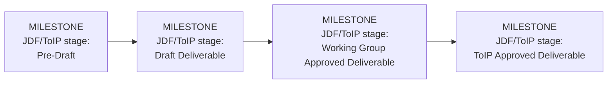
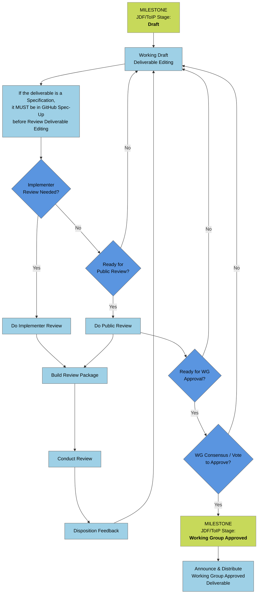
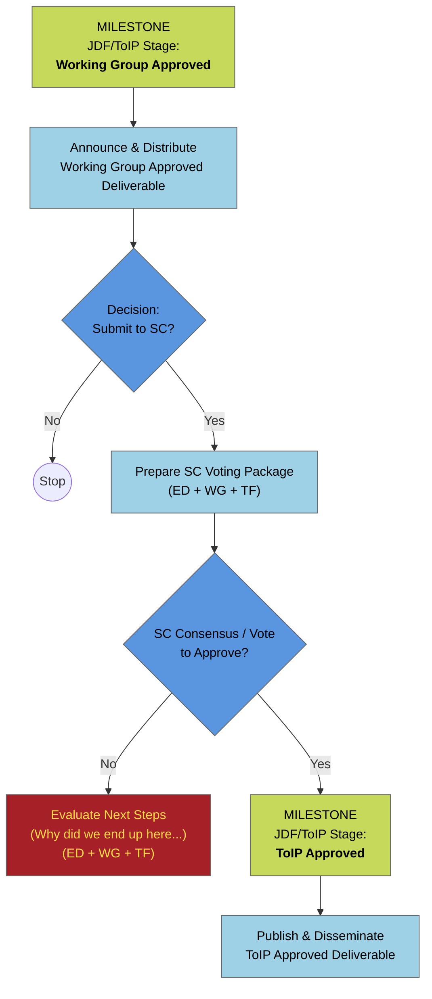

# Stages of Development for Working Groups & Task Forces - DRAFT
[Confluence Source](https://lf-toip.atlassian.net/wiki/spaces/HOME/pages/22996901/Stages+of+Development+for+Working+Groups+Task+Forces)

# Deliverable Classification

Before beginning work, the Working Group shall classify the effort into one of the following categories.

## Change Types

| Change Type | Description | Version Increment |
|-------------|-------------|------------------|
| **New Deliverable** | Creation of a new deliverable | `1.0.0` |
| **Major Revision** | Substantive changes to scope, requirements, architecture, normative content, or recommendations | `X.0.0` |
| **Minor Revision** | Backwards-compatible additions, clarifications, new examples, or limited new content | `X.Y.0` |
| **Patch Revision** | Editorial corrections, typo fixes, formatting improvements, broken links, or other non-substantive clarifications | `X.Y.Z` |

## Approval Paths

| Change Type | Working Group Approval | Public Review | Steering Committee Review |
|-------------|-----------------------|---------------|---------------------------|
| **New Deliverable** | Required | Required | Required for ToIP Approved status |
| **Major Revision** | Required | Required | Full Steering Committee approval |
| **Minor Revision** | Required | Not normally required | Notification and passive review |
| **Patch Revision** | Required | Not required | Not required |

This classification determines which approval pathway applies to the proposed work and the level of review required before publication.

# List of Stages

Although the specific needs of each Working Group (WG) and Task Force (TF) may vary, the following table describes the recommended stages in the development of a ToIP deliverable (e.g., a specification, guide, template, or white paper).

| # | Stage | Activity | Exit Criteria |
|---|--------|----------|--------------|
| 1 | **Initiation** | Introduce members; agree on vision, mission, scope, process, tools, and schedule | Consensus on vision, mission, scope, process, tools, and schedule |
| 2 | **Problem Definition** | Stakeholders propose use cases to build a map of what problems they need to solve for whom | Consensus on the problem map |
| 3 | **Requirements** | Extract and enumerate specific requirements from the problem map | Consensus on requirements |
| 4 | **Design Principles** | Develop the principles that should guide/govern design of the solution | Consensus on design principles |
| 5 | **Proposals** | Members submit proposed solution designs | No further proposals |
| 6 | **Consolidation** | Members identify common elements and seek to develop a consolidated proposal | Consensus on contents of first Working Draft |
| 7 | [**Working Drafts**](#stage-7-working-drafts) † | A cycle of publishing Working Drafts, raising and resolving issues, and agreeing on revisions | Consensus on first Implementers Draft or Public Review Draft |
| 8 | [**Implementers Drafts**](stage-8-implementers-drafts-optional) | *Optional* — recommended for technical specifications where implementation feedback is desired prior to finalization | Consensus that sufficient implementation feedback has been received |
| 9 | [**Public Review Drafts**](#stage-9-public-review-drafts) | Same as Working Draft stage except with public review | Consensus (or vote) on WG Approved Draft |
| 10 | [**WG Approved Draft**](#stage-10-wg-approved-draft) † | WG decision to submit for SC approval | Consensus (or vote) to submit for SC approval |
| 11 | [**ToIP Approved Draft**](#stage-11-toip-approved-draft) † | SC decision to approve as ToIP Deliverable | Consensus (or vote) to approve |
| 12 | [**Maintenance**](#stage-12-deliverable-maintenance) | Major, minor and patch updates to existing standards | Dependent on type of update |

† Stages officially recognized in the Linux Foundation Joint Development Foundation process: **Pre-Draft**, **Draft**, **Working Group Approved**, and **ToIP Approved** deliverables.

---

# Stages 1 Through 6 (Prior to Working Drafts)

It is understandable that many WGs or TFs (collectively, "groups") may want to get right to work, that is, pick up the pen and start drafting. Some may even have been started based on a contributed document or specification.

However, we strongly recommend that the group still **take the time to deliberately go through stages 1 through 6** in order to ensure all group members are aligned and working from the same conclusions about the mission, scope, problem definition, and requirements.

It is also highly recommended that all group members have the opportunity to present their own proposed solutions. This is the best way to build toward consensus in the Consolidation stage prior to formally commencing Working Drafts.

# Stage 7: Working Drafts

When the group is ready to begin drafting, it must decide which collaboration tools it will use. ToIP offers two choices:

## Google Docs

This option is recommended if the group wants to minimize barriers for contributors. It can work well for non-technical deliverables, where intellectual property rights (IPR) for contributions are usually not an issue.

In addition, Google Docs is a low-friction tool for the early stages of drafting technical specifications, though it is still important to keep a clear record of which ToIP members make which contributions.

> Note: This option is not yet supported by [Spec-up-T](https://trustoverip.github.io/spec-up-t-website/) for automatic linking and annotation of glossary terms.

### Guidelines

1. Any Google Docs used should be stored in the ToIP Shared Drive for your WG (or in a subfolder of the WG for your TF). This allows you to assure that any contributions are being made by ToIP members who have access to these shared drives.
2. No Google Docs used for the creation of ToIP deliverables should be stored outside of the ToIP Shared Drives.
3. Any deliverable whose entire production uses Google Docs should be converted into the ToIP Word Template before submission for approval as a Working Group Approved Draft (Stage 10).
4. If a WG or TF member has difficulty accessing the ToIP Shared Drive, please contact [LFDT Support](support@lfdecentralizedtrust.org) for assistance.

## GitHub Markdown Documents

This option **must** be used for the final form of all ToIP technical specifications.

It is also **recommended** for all other ToIP deliverables whenever possible because it provides a strict, verifiable, date-stamped record of all contributions by author.

GitHub Markdown is also the recommended final form for any ToIP deliverable that wishes to take advantage of Terminology Engine tools for automatic linking and annotation of glossary terms.

### Guidelines

1. Contact your Working Group chair(s), or [LFDT Support](support@lfdecentralizedtrust.org) for assistance in setting up the GitHub repository needed to manage your deliverable.
2. See the instructions for setting up your repository and beginning use of the ToIP Markdown Template for your deliverable.

## Working Draft Subtitle and Versioning

Regardless of whether Google Docs or GitHub Markdown is used, the document should carry the subtitle:

> Working Draft XX

where `XX` is a two-digit version number beginning with `01`.

Examples:

- Working Draft 01
- Working Draft 02
- Working Draft 03

and so on.

# Stage 8: Implementers Drafts (Optional)

If a deliverable is a technical specification, it is recommended to follow the IETF dictum of **"rough consensus and running code"**, that is, to provide evidence of completeness by demonstrating multiple interoperable implementations.

The best way to do this is to publish at least one **Implementers Draft** that developers can actively use to implement and provide feedback on the specification.

Depending on the complexity of the specification, more than one version of the Implementers Draft may be published. This cycle will typically last at least a few months and may continue for a year or more.

Explicitly labeling a specification as an **Implementers Draft** sends a clear signal that:

- The specification is ready for implementation feedback.
- The Working Group values implementation experience before the specification is finalized.
- Changes may still be made based on practical implementation results.

## Implementers Draft Subtitle and Versioning

The document should carry the subtitle:

> Implementers Draft XX

where `XX` is a two-digit version number beginning with `01`.

Examples:

- Implementers Draft 01
- Implementers Draft 02
- Implementers Draft 03

and so on.

The Implementers Draft version numbering is entirely independent of the Working Draft version numbering.

For example, a group may transition directly from:

> Working Draft 07

to

> Implementers Draft 01

without any relationship between the numbering schemes.

# Stage 9: Public Review Drafts

Before a Working Draft or Implementers Draft can be submitted for approval as a Working Group Approved Draft, it **must** be subject to at least one public review period of **at least 15 days**. A review period of **30 to 60 days is recommended**.

Either a Working Group or Task Force may trigger a public review draft.

For technical specifications, it is recommended to wait until sufficient implementation feedback has been received before beginning public review.

For all other deliverables, the group may determine when the deliverable is ready for public review.

## Guidelines

1. The document **must** carry the subtitle:

   > Public Review Draft XX

   where `XX` is a two-digit version number beginning with `01`.

   Examples:

   - Public Review Draft 01
   - Public Review Draft 02
   - Public Review Draft 03

   The Public Review Draft version numbering is independent of both Working Draft and Implementers Draft numbering.

   Example progression:

   > Working Draft 11  
   > Implementers Draft 02  
   > Public Review Draft 01

2. The deliverable **must** be posted to a ToIP GitHub repository, even if the deliverable itself is maintained as a Google Doc, Word document, or PDF.

3. The public review process **must** use GitHub Issues for collecting and tracking feedback.

4. All feedback from non-ToIP members **must** use the Feedback License as specified by the Joint Development Foundation (JDF).

5. The group **must** publish a ToIP blog post announcing the public review. The blog post should:

   - Explain the background of the deliverable.
   - Describe the purpose of the deliverable.
   - Provide instructions for submitting feedback.
   - Invite participation from both ToIP members and non-members.

6. The ToIP Working Group Chair or Executive Director **must** send a notice of the public review to:

   - The ToIP All-Members mailing list.
   - The ToIP Steering Committee.

   The notice should include:

   - A synopsis of the deliverable.
   - A link to the blog post announcing the review.

7. The official public review period **must not begin earlier** than the day that both:

   - The blog post is published, and
   - The notification email is sent.

8. The group **must** process all feedback received during the review period by either:

   - Incorporating the feedback into the deliverable, or
   - Explaining why the feedback was not incorporated.

   Responses should be recorded in the corresponding GitHub Issue(s).

9. If feedback results in significant changes to the deliverable, the group **may** conduct one or more additional rounds of public review.

   Any additional review rounds **must** follow the same requirements as the initial public review process.

## Outcome

Successful completion of the Public Review Draft stage results in:

- All public feedback being reviewed and addressed.
- Any necessary revisions being completed.
- Consensus (or a formal vote, if required) to move forward to the **Working Group Approved Draft** stage.

# Stage 10: WG Approved Draft

Once public review is complete and the Working Group (WG) or Task Force (TF) has responded to all issues raised, the deliverable is ready to be submitted for approval as a **Working Group Approved Draft**.

Approval **must** be obtained through a formal call for consensus using one of the following methods:

1. A meeting of the Working Group for which at least one week's notice has been given of the planned call for consensus; **or**
2. An email sent to the Working Group mailing list that allows at least seven calendar days for any WG member to respond with an objection.

## Requirements for an Email Call for Consensus

The email **must** include the following information:

1. The formal name of the deliverable, which must conform to the applicable ToIP naming requirements.

2. A link to the final Public Review Draft being submitted for approval.

   - This must be a link to the WG or TF GitHub repository.
   - If the deliverable is a Google Doc or Word document, a PDF version must be posted to the repository.
   - If the deliverable is maintained in Markdown, the email should link directly to the Markdown document.

3. A synopsis of the deliverable.

   - This may be the same synopsis used during the public review process.

4. A link to the blog post that announced the public review.

5. A link to the GitHub Issue (or Issues) summarizing the resolution of all feedback received during public review.

6. A link to the ToIP deliverable process documentation.

7. A formal call for consensus statement such as:

   > This is a formal call for consensus of the members of the \<WG Name\> for approval of \<Deliverable Name\> at \<Link to Final Public Review Draft\> as a Working Group Approved Deliverable.

8. Instructions stating that:

   - Any WG member wishing to object must publicly respond to the email stating their objection.
   - If no objections are received within seven calendar days, the deliverable will be considered approved.

## Approval by Consensus

If no objections are received during the call for consensus period, the deliverable **shall be approved** as a Working Group Approved Draft.

## Approval by Ballot

If an objection is raised and cannot be resolved through discussion, the Working Group **must** hold a formal ballot.

### Approval at a Working Group Meeting

To be approved during a meeting:

- A majority (51%) of Working Group members present must vote in favor of approval.

### Approval by Email Ballot

To be approved through an email ballot:

- A majority (51%) of Working Group members on the mailing list must vote in favor of approval.

## Outcome

Successful completion of this stage results in the deliverable becoming a:

> **Working Group Approved Draft**

The deliverable may then proceed to consideration as a **ToIP Approved Draft**.

# Stage 11: ToIP Approved Draft

Once a deliverable has been approved as a **Working Group Approved Draft**, the Working Group may elect to submit it to the **ToIP Steering Committee (SC)** for approval as a **ToIP Approved Draft**.

Submission to the Steering Committee is optional and should occur only if the Working Group believes the deliverable is ready for consideration as an official ToIP deliverable.

## Steering Committee Approval

If a majority of the Working Group supports moving the deliverable forward, the group should follow the established [**ToIP Approved Deliverable Process**](toip_approved_deliverable.md) for submission to the Steering Committee.

The Steering Committee will review the deliverable and determine whether it should be approved as a ToIP deliverable.

## Outcome

Successful completion of this stage results in the deliverable becoming a:

> **ToIP Approved Draft**

This represents the highest level of approval within the ToIP deliverable process and signifies that the deliverable has been reviewed and approved by the ToIP Steering Committee.

# Stage 12: Deliverable Maintenance

Once a deliverable has been approved, it enters a maintenance phase during which revisions may be made.

Maintenance revisions shall be classified as:

- Major revisions
- Minor revisions
- Patch revisions

## Patch Revisions

Patch revisions are intended for non-substantive changes such as:

- Typographical corrections
- Formatting corrections
- Broken link fixes
- Editorial improvements
- Clarifications that do not alter meaning

Patch revisions:

1. Must be approved by the Working Group.
2. Do not require public review.
3. Do not require Steering Committee approval.
4. Shall increment the patch version number.
5. Shall maintain the same major and minor version numbers.
6. The Working Group shall maintain a change log documenting the patch changes.

For ToIP Approved Deliverables:

7. The updated deliverable shall be uploaded to the same Zenodo record series used for previous versions.
8. The title shall be updated to include the new patch version (e.g. 1.0.1)

## Minor revisions:

1. Require Working Group approval.
2. Do not normally require public review.
3. Require publication of a **Revision Impact Statement**.
4. Require notification to the Steering Committee a minimum of two weeks before a Steering Committee meeting.
5. Shall increment the minor version number.
6. Shall reset the patch version number to zero.

For ToIP Approved Deliverables:

7. The updated deliverable shall be uploaded to a new Zenodo record and assigned a new DOI.

Additional Steering Committee review requirements:

- The Steering Committee may request that a proposed minor revision be reclassified as a major revision.
- The Steering Committee may discuss the proposed revision at any Steering Committee meeting following notification by the Working Group.
- If the Steering Committee does not object, request remediation, or request reclassification to a major revision within two weeks following the Steering Committee meeting at which the revision was presented, the revision shall be considered approved by the Steering Committee.
- Once accepted, the Working Group may publish the minor revision and proceed with any associated DOI and Zenodo publication activities.

### Revision Impact Statement

A brief page or less which lists:
- Summary of changes
- Rationale
- Impact assessment
- Why the WG believes this is minor

## Major Revisions

Major revisions materially change the content, scope, requirements, recommendations, or architecture of an approved deliverable.

Examples include:

- Significant new requirements
- Removal of previously approved content
- Breaking changes
- Major restructuring
- Significant changes in recommendations or guidance

Major revisions:

1. Require Working Group approval.
2. Require public review.
3. Require Steering Committee approval.
4. Shall increment the major version number.
5. Shall reset the minor and patch version numbers to zero.

For ToIP Approved Deliverables:

6. The updated deliverable shall be uploaded to a new Zenodo record series and granted a new DOI.

Major revisions shall follow the same review and approval process as a new deliverable beginning at the Working Draft stage.

---

# Summary of Deliverable Progression

The complete progression of a ToIP deliverable can be summarized as:

1. Initiation
2. Problem Definition
3. Requirements
4. Design Principles
5. Proposals
6. Consolidation
7. Working Drafts
8. Implementers Drafts *(optional)*
9. Public Review Drafts
10. Working Group Approved Draft
11. ToIP Approved Draft

## Mapping to LF/JDF Deliverable Stages

| ToIP Stage | LF/JDF Deliverable Status |
|------------|--------------------------|
| Stages 1–6 | Pre-Draft |
| Stage 7 (Working Drafts) | Draft Deliverable |
| Stage 10 (WG Approved Draft) | Working Group Approved Deliverable |
| Stage 11 (ToIP Approved Draft) | ToIP Approved Deliverable |

The Implementers Draft and Public Review Draft stages are optional and intermediate stages used to improve the quality, interoperability, and community review of a deliverable prior to formal approval.

Diagram of the progression:

## Draft to Working Group Approved

This stage typically represents the longest period of work in the deliverable lifecycle, both technically and socially. The objective is to evolve a draft into a formal Working Group approved deliverable through iterative review, feedback, revision, and consensus-building.

The effort required varies significantly by deliverable type:

- **Informational deliverables** (for example, white papers, guidance documents, and reports) may proceed through review relatively quickly.
- **Normative deliverables** (for example, technical specifications) often require extensive review, implementation experience, issue resolution, consensus building, and formal approval processes.

The workflow includes preparation for review, optional implementer review, public review, disposition of review comments, repeated editing cycles, and eventual Working Group approval.

Diagram of the progression:

## Working Group Approved to ToIP Approved

